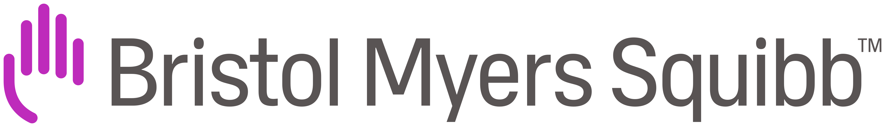

Bio
======
Hi everyone!   
I'm Elia Cunegatti, a fourth-year Ph.D. student at the University of Trento, Italy ⛰️.  
On this website, you’ll find everything related to my research activities.   

My main focus is **Efficient Deep Learning**  where I work on making large models lighter, faster, and more resource-efficient through pruning, sparsity, and other model compression techniques. In my spare time, I enjoy exploring graph-related problems and evolutionary computation ideas. 

I also occasionally teach and I’m actively involved in supervising student projects and theses.  

Updates 🔥
======

🎉 **Aug 2026** 
Two papers accepted at **EMNLP 2026**! 
**From Layers to Submodules: Rethinking Granularity in Replacement-Based LLM Compression** — Findings · <a href="https://arxiv.org/abs/2606.02559">[paper]</a> <a href="https://github.com/eliacunegatti/SubFit">[code]</a> 
**Frequency Matters: Fast Model-Agnostic Data Curation for Pruning and Quantization** — Main Conference · <a href="https://arxiv.org/abs/2603.16105">[paper]</a> <a href="https://github.com/FrancescoMonaco/ZipCal">[code]</a>

---

💼 **Apr–Jun 2026** 
<strong>Visiting PhD Scientist</strong> at <strong>Bristol Myers Squibb (CITRE)</strong> in Seville, Spain 
Worked on generating Gene Regulatory Networks from scientific literature using Large Language Models, with Dr. Santiago Egea Gomez and Dr. Hannah Pliner.
