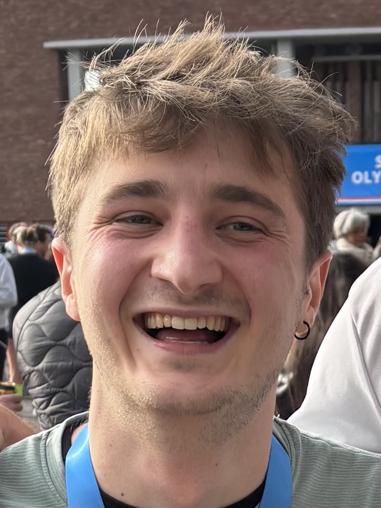
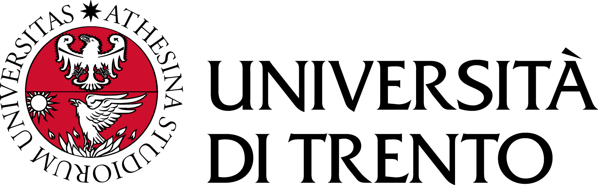

<section class="home-hero" aria-labelledby="hero-title">
  

    
AI Researcher

    <h1 id="hero-title">Applied AI for <em>efficient LLMs.</em></h1>
    
Hi, I’m Elia — an Applied AI Researcher and fourth-year PhD candidate at the University of Trento, with experience across academia and industry.

    
My research focuses on model compression, pruning, sparsity, data curation, and post-training for large language models.

    

      <a class="action action--primary" href="/publications/">Explore my research ↗</a>
      <a class="action action--secondary" href="/files/EliaCunegatti_CV.pdf">Download CV ↓</a>
    

    

      <a href="mailto:elia.cunegatti@unitn.it">Email</a>
      <a href="https://github.com/eliacunegatti">GitHub</a>
      <a href="https://scholar.google.com/citations?user=a2JJRjMAAAAJ&amp;hl=en&amp;oi=ao">Google Scholar</a>
      <a href="https://twitter.com/CunegattiElia">X / Twitter</a>
    

  

  

    <figure class="portrait-card">
      
    </figure>
  

</section>

<section class="focus-strip" aria-label="Research areas">
  
01 Model compression

  
02 Efficient LLMs

  
03 Post-training

</section>

<section class="home-section latest-work" aria-labelledby="latest-title">
  <header class="section-heading">
    

      
Presented at EMNLP 2026

      <h2 id="latest-title">Latest work</h2>
    

    <a href="/publications/">All publications →</a>
  </header>

  

    <article class="paper-card paper-card--blue">
      

        EMNLP 2026 · Findings
        01
      

      <h3>From Layers to Submodules: Rethinking Granularity in Replacement-Based LLM Compression</h3>
      
Submodule-level compression with lightweight fitted residual bypasses.

      

        <a href="https://arxiv.org/abs/2606.02559">Paper ↗</a>
        <a href="https://github.com/eliacunegatti/SubFit">Code ↗</a>
      

    </article>

    <article class="paper-card paper-card--blue">
      

        EMNLP 2026 · Main
        02
      

      <h3>Frequency Matters: Fast Model-Agnostic Data Curation for Pruning and Quantization</h3>
      
Fast, Zipf-inspired calibration data selection for model compression.

      

        <a href="https://arxiv.org/abs/2603.16105">Paper ↗</a>
        <a href="https://github.com/FrancescoMonaco/ZipCal">Code ↗</a>
      

    </article>
  

</section>

<section class="home-section field-note" aria-labelledby="amazon-title">
  

    
Now · Turin, Italy

    
  

  

    <h2 id="amazon-title">Post-training at Alexa AI.</h2>
    
I am currently an Applied Scientist Intern at Amazon in Turin, working with Alexa AI on post-training.

  

</section>

<section class="home-section field-note" aria-labelledby="field-title">
  

    
Apr–Jun 2026 · Seville, Spain

    
  

  

    <h2 id="field-title">From papers to biomedical discovery.</h2>
    
Between April and June 2026, I joined Bristol Myers Squibb (CITRE) in Seville as a Visiting Scientist. I worked with Dr. Santiago Egea Gomez and Dr. Hannah Pliner on generating gene regulatory networks from scientific literature using large language models.

  

</section>

<section class="home-section field-note" aria-labelledby="phd-title">
  

    
Since 2022 · Trento, Italy

    
  

  

    <h2 id="phd-title">PhD student at the University of Trento.</h2>
    
I have been a PhD student in Computer Science at the University of Trento since 2022, researching efficient deep learning, model compression, pruning, and sparsity.

  

</section>

